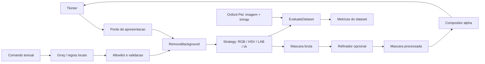

# Removedor de Fundo de Animais

Aplicacao Python para remover o fundo de imagens com segmentacao tradicional ou modelo de visao, preservar mascaras antes/depois do refinamento e executar experimentos com o dataset Oxford-IIIT Pet.

## Arquitetura

```text
removedor_fundo/
├── domain/                         # Modelos, contratos e erros sem dependencias externas
├── application/use_cases/          # Remocao, comparacao, avaliacao do dataset e comandos
├── infrastructure/
│   ├── datasets/                   # Leitura de pares Oxford Pet (imagem + trimap)
│   ├── evaluation/                 # Metricas calculadas exclusivamente com trimaps
│   ├── generative/                 # Interpretadores Groq e local por regras
│   ├── imaging/                    # Inspecao de mascaras e composicao OpenCV
│   ├── refinement/                 # Refinamento morfologico
│   ├── segmentation/               # Estrategias RGB/HSV/LAB e TorchVision
│   ├── storage/                    # Persistencia de resultados/experimentos
│   └── logging_config.py
├── presentation/                   # Ponto de entrada desktop
└── bootstrap.py                    # Composicao e injecao dos adaptadores

Front/
├── remover_frontend_v2.py          # Janela Tkinter e ciclo de vida da aplicacao
├── ui_components.py                # Componentes visuais reutilizaveis
└── backend_bridge.py               # Adaptador entre UI e caso de uso

tests/unit/                         # Testes de contratos e casos de uso
```

## Catalogo detalhado dos arquivos

Este catalogo descreve os arquivos mantidos pelo projeto. Ele nao enumera os
arquivos internos do Oxford-IIIT Pet, do ambiente virtual (`venv/` ou
`.venv/`), caches, arquivos temporarios nem resultados gerados (`output/`,
`artifacts/` e `removedor_fundo.egg-info/`), pois esses itens sao dados locais
ou artefatos de execucao, nao codigo-fonte. O `.env` tambem e local e nao deve
ser compartilhado; somente os nomes das configuracoes necessarias sao
documentados.

### Pacote `removedor_fundo/`

#### Raiz e apresentacao

- `removedor_fundo/__init__.py`: identifica `removedor_fundo` como pacote
  Python importavel.
- `removedor_fundo/bootstrap.py`: composition root; instancia segmentadores,
  refinador, inspetor, compositor, avaliador e interpretadores e os injeta nos
  casos de uso.
- `removedor_fundo/presentation/__init__.py`: identifica a camada de
  apresentacao como subpacote.
- `removedor_fundo/presentation/desktop.py`: define `main()`, configura logs e
  abre a janela Tkinter; e o destino do comando `removedor-fundo`.

#### Dominio

- `removedor_fundo/domain/__init__.py`: identifica o subpacote de dominio.
- `removedor_fundo/domain/models.py`: declara os dados trocados entre camadas,
  incluindo `RemovalRequest`, `ProcessingResult`, `DatasetSample`,
  `DatasetEvaluation` e `UserCommand`.
- `removedor_fundo/domain/contracts.py`: declara protocolos para segmentadores,
  refinadores, avaliadores, compositores, interpretadores e repositorios; sao
  os contratos que permitem trocar implementacoes sem acoplar os casos de uso
  a OpenCV, Groq ou TorchVision.
- `removedor_fundo/domain/errors.py`: define a hierarquia de erros conhecidos
  da aplicacao, como metodo desconhecido, mascara invalida, segmentacao
  insegura e comando invalido.

#### Aplicacao e casos de uso

- `removedor_fundo/application/__init__.py`: identifica a camada de aplicacao.
- `removedor_fundo/application/use_cases/__init__.py`: identifica o subpacote
  de casos de uso.
- `removedor_fundo/application/use_cases/remove_background.py`: coordena a
  remocao em uma imagem; gera a mascara bruta, valida forma e area, refina uma
  copia quando solicitado e compoe a imagem com transparencia. Nao avalia
  contra trimaps.
- `removedor_fundo/application/use_cases/compare_methods.py`: executa
  segmentadores selecionados sobre a mesma imagem e retorna resultados
  visuais; nao calcula metricas de qualidade.
- `removedor_fundo/application/use_cases/evaluate_dataset.py`: percorre
  amostras pareadas com trimaps, executa metodos e solicita metricas para as
  mascaras bruta e refinada.
- `removedor_fundo/application/use_cases/execute_command.py`: valida a
  estrutura, acao e parametros de um comando interpretado e encaminha a acao
  somente para handlers locais autorizados.

#### Infraestrutura

- `removedor_fundo/infrastructure/__init__.py`: identifica o subpacote de
  infraestrutura.
- `removedor_fundo/infrastructure/logging_config.py`: configura o logging da
  aplicacao; permite escolher o nivel com `LOG_LEVEL`.
- `removedor_fundo/infrastructure/datasets/__init__.py`: expoe o repositorio
  Oxford-IIIT Pet do subpacote.
- `removedor_fundo/infrastructure/datasets/oxford_pet.py`: localiza imagens e
  trimaps, carrega pares, verifica dimensoes/rotulos e cria amostras para
  experimentos. Aceita `OXFORD_PET_DATASET` para indicar outra raiz.
- `removedor_fundo/infrastructure/evaluation/__init__.py`: identifica o
  subpacote de avaliacao.
- `removedor_fundo/infrastructure/evaluation/trimap_evaluator.py`: calcula
  IoU, precisao, recall, F1, acuracia e indicadores da regiao incerta usando
  as classes do trimap; nao e usado pelo fluxo de imagens avulsas.
- `removedor_fundo/infrastructure/generative/__init__.py`: identifica o
  subpacote de interpretacao generativa.
- `removedor_fundo/infrastructure/generative/groq_interpreter.py`: envia texto
  de comando a Groq e converte a resposta JSON em uma proposta estruturada;
  nao recebe nem envia imagens.
- `removedor_fundo/infrastructure/generative/groq_result_explainer.py`:
  solicita a Groq uma explicacao textual baseada somente em metadados
  escalares permitidos do resultado.
- `removedor_fundo/infrastructure/generative/rule_based_interpreter.py`:
  interpreta localmente pedidos simples, sem chamada de rede, quando o modo
  local e usado ou a chave Groq nao esta configurada.
- `removedor_fundo/infrastructure/imaging/__init__.py`: expoe utilitarios de
  carregamento e salvamento de imagem do adaptador OpenCV.
- `removedor_fundo/infrastructure/imaging/opencv_adapters.py`: implementa
  inspecao de mascaras, composicao RGBA/alpha, validacao e operacoes basicas
  de leitura e escrita com OpenCV.
- `removedor_fundo/infrastructure/refinement/__init__.py`: identifica o
  subpacote de refinamento.
- `removedor_fundo/infrastructure/refinement/opencv_refiner.py`: executa
  refinamento morfologico e disponibiliza abertura, fechamento, erosao,
  dilatacao e gradiente usando OpenCV.
- `removedor_fundo/infrastructure/segmentation/__init__.py`: identifica o
  subpacote de segmentacao.
- `removedor_fundo/infrastructure/segmentation/labels.py`: mapeia nomes de
  objetos em portugues para classes VOC do modelo e normaliza texto.
- `removedor_fundo/infrastructure/segmentation/opencv_segmenters.py`:
  implementa as estrategias de limiar por cor nos espacos RGB, HSV e LAB.
- `removedor_fundo/infrastructure/segmentation/torchvision_segmenter.py`:
  carrega sob demanda o DeepLabV3 do TorchVision e produz mascara para as
  classes do objeto solicitado.
- `removedor_fundo/infrastructure/storage/__init__.py`: identifica o
  subpacote de persistencia.
- `removedor_fundo/infrastructure/storage/local_artifacts.py`: grava
  resultados, mascaras e metadados em arquivos locais sob `artifacts/`.

#### Arquivos `__init__.py`

Os `__init__.py` que nao foram descritos individualmente acima (`application`,
`domain`, `infrastructure` e os subpacotes sem exportacoes) marcam os
diretorios como pacotes Python. Os que estao em `datasets/` e `imaging/`
tambem expoem nomes convenientes para importacao.

### Interface grafica `Front/`

- `Front/__init__.py`: torna `Front` importavel como pacote Python.
- `Front/icons.py`: guarda os desenhos SVG inline usados pelos controles da
  interface, evitando misturar os dados dos icones com a logica da janela.
- `Front/ui_components.py`: define componentes visuais reutilizaveis,
  estilos, botoes, seletores, area de preview, progresso e controles da
  janela. Nao executa os casos de uso de negocio.
- `Front/backend_bridge.py`: adaptador entre a interface e o nucleo; valida
  opcoes, carrega a imagem, chama `RemoveBackground` e converte o resultado
  para preview PIL. E executado numa thread de trabalho pela janela.
- `Front/remover_frontend_v2.py`: monta a janela principal, coleta as opcoes,
  inicia o processamento em segundo plano, atualiza a interface pela fila e
  permite salvar o resultado.

### Compatibilidade e utilitarios na raiz

Estes modulos permanecem fora do pacote por serem entradas antigas,
ferramentas de analise ou utilitarios compartilhados. As fachadas conservam
nomes de funcoes ja usados pelos scripts existentes; regras novas devem ser
implementadas no pacote `removedor_fundo/`.

- `ai.py`: fachada de compatibilidade para interpretacao/validacao de
  comandos, classificacao de objetos e explicacao dos resultados; encaminha
  operacoes aos adaptadores de IA.
- `dataset_utils.py`: fachada que preserva funcoes antigas para listar
  imagens, localizar trimaps e carregar pares do Oxford Pet.
- `evaluation.py`: fachada que preserva `avaliar_mascara()` e encaminha a
  avaliacao para `OxfordPetTrimapEvaluator`.
- `segmentation.py`: fachada das funcoes antigas de segmentacao por cor e
  morfologia; delega aos adaptadores OpenCV.
- `image_processing.py`: utilitarios de baixo nivel para validar, converter,
  mascarar, compor alpha, carregar e salvar imagens no formato usado pelo
  OpenCV. E utilizado pelos scripts e fachadas de compatibilidade.
- `pipeline.py`: fachada/orquestrador de compatibilidade que conecta os casos
  de uso com os antigos fluxos de comando e experimento; tambem oferece uma
  entrada de linha de comando para processar um pedido textual.
- `tools.py`: implementa as funcoes de compatibilidade que podem ser
  acionadas por comandos autorizados, com allowlist e verificacao de
  argumentos; nao permite ao modelo fornecer codigo executavel.
- `fft_analysis.py`: calcula e apresenta analises FFT gerais de imagens,
  espectro, magnitude e fase para os experimentos visuais.
- `fft_mascara.py`: calcula medidas e visualizacoes de frequencias das
  mascaras para observar caracteristicas como bordas e ruido.
- `experimento_lote.py`: seleciona imagens do Oxford Pet, compara metodos
  com e sem refinamento, calcula metricas/FFT e salva tabelas e graficos.
- `main.py`: script exploratorio de analise visual; carrega uma amostra do
  dataset, gera mascaras e graficos/histogramas. A execucao fica protegida
  pelo ponto de entrada do script para que um import nao abra os graficos.

### Testes automatizados

- `tests/__init__.py`: identifica o pacote de testes.
- `tests/unit/__init__.py`: identifica o subpacote de testes unitarios.
- `tests/unit/test_application_use_cases.py`: testa regras dos casos de uso,
  preservacao da mascara bruta, validacao de segmentacao e despacho de
  comandos.
- `tests/unit/test_dataset_metric_boundary.py`: verifica que metricas por
  trimap permanecem no fluxo experimental e nao aparecem no processamento
  avulso.
- `tests/unit/test_frontend_button_callbacks.py`: testa eventos de pressionar
  e soltar botoes, restauracao de cor e comportamento de botao desativado.
- `tests/unit/test_legacy_compatibility.py`: confirma que as fachadas antigas
  de segmentacao, refinamento e avaliacao mantem resultados compativeis com
  os adaptadores atuais.
- `tests/unit/test_presentation_adapters.py`: verifica a ponte Tkinter e o
  fluxo local de comando sem exigir trimap.

### Documentacao, dependencias e configuracao

- `README.md`: descreve arquitetura, responsabilidades, fluxos, instalacao,
  execucao e testes; este catalogo e o inventario dos arquivos de codigo.
- `ROADMAP.md`: registra objetivos e historico de desenvolvimento/
  experimentos; suas secoes antigas sao referencia historica e podem
  apresentar uma organizacao anterior a arquitetura atual.
- `pyproject.toml`: configura o pacote instalavel, versao minima de Python,
  dependencias, descoberta de pacotes e comando `removedor-fundo`.
- `requirements.txt`: lista dependencias Python para instalacao via pip.
- `.gitignore`: exclui do controle de versao ambientes virtuais, segredos,
  caches, datasets e resultados gerados.
- `.env`: configuracao local opcional com segredos, como `GROQ_API_KEY`; e
  ignorado pelo Git, nao deve ser documentado com valores nem compartilhado.



`ai.py`, `dataset_utils.py`, `evaluation.py`, `segmentation.py` e `pipeline.py` preservam as APIs antigas como fachadas de compatibilidade; as implementacoes usadas pelo nucleo ficam em `removedor_fundo/`. `main.py`, `image_processing.py` e os modulos FFT continuam como ferramentas dos experimentos visuais/acadêmicos. `main.py` so executa os graficos quando chamado como script; importa-lo nao inicia o experimento.

## Dois fluxos separados

### Imagem enviada pelo usuario

```text
Tkinter -> backend_bridge -> RemoveBackground
                          -> Segmenter escolhido (Strategy)
                          -> mascara bruta -> refinador opcional -> mascara processada
                          -> composicao alpha -> preview / salvar pelo usuario
```

Esse fluxo nao procura uma imagem correspondente no Oxford Pet, nao carrega trimap e nao calcula IoU, precisao, recall, F1, acuracia ou metricas de incerteza. A proporcao de area usada internamente e apenas uma validacao de seguranca da mascara; nao e uma avaliacao contra ground truth. O usuario escolhe onde salvar o resultado.

### Experimentos do Oxford-IIIT Pet

```text
OxfordPetDatasetRepository -> DatasetSample (imagem + trimap)
                            -> EvaluateDataset -> mascara bruta e refinada
                            -> OxfordPetTrimapEvaluator -> metricas
                            -> tabelas/artefatos do experimento
```

Somente esse fluxo recebe trimaps e calcula metricas de qualidade. Sem trimap, comparacoes visuais podem gerar e exibir mascaras, mas os campos de avaliacao ficam ausentes e os relatorios de metricas nao sao gravados.

## Responsabilidades e contratos

- `domain/models.py`: `RemovalRequest`, `ProcessingResult`, `DatasetSample` e `DatasetEvaluation`.
- `domain/contracts.py`: protocolos `Segmenter`, `MaskRefiner`, `MaskInspector`, `ImageComposer`, `MaskEvaluator`, `CommandInterpreter` e repositorios.
- `RemoveBackground`: injeta estrategias, refinador, inspetor e compositor. Nao conhece datasets nem avaliadores. Mantem `raw_mask` intacta e entrega ao refinador uma copia.
- `CompareMethods`: compara saidas visuais sem consultar avaliadores.
- `EvaluateDataset`: exige amostras com trimaps e calcula, separadamente, metricas da mascara bruta e processada.
- `ExecuteCommand`: valida acao, metodo e tipos contra uma allowlist e despacha somente handlers locais registrados.
- `bootstrap.py`: composition root que monta adaptadores concretos; casos de uso podem receber fakes nos testes.
- `TorchVisionSegmenter` gera a mascara; a camada generativa recebe apenas texto e devolve uma proposta de comando. Nenhuma imagem ou pixel e enviado a Groq.
- `Front/backend_bridge.py` converte caminhos, configuracoes e formatos entre Tkinter e os casos de uso. A UI continua processando em uma thread trabalhadora e atualizando widgets pela fila da thread principal.

Exemplo de injecao:

```python
use_case = RemoveBackground(
    segmenters={"rgb": rgb_segmenter, "ia": torchvision_segmenter},
    refiner=morphological_refiner,
    inspector=mask_inspector,
    composer=image_composer,
)
result = use_case.execute(
    RemovalRequest(image=image, method="ia", object_name="cachorro", refine=True)
)
```

Para adicionar um segmentador, implemente `generate_mask(image, object_name=..., parameters=...)` e registre-o em `bootstrap.build_segmenters()`. O caso de uso e a interface nao precisam mudar. Um novo refinador implementa `refine(mask, parameters=...)`; uma nova metrica implementa `evaluate(mask, trimap)` e e conectada apenas ao fluxo de dataset.

## Requisitos

- Python 3.10 ou superior.
- Dependencias instaladas via `requirements.txt` ou pelo pacote editavel.
- Pesos do TorchVision sao baixados na primeira inferencia de IA; a primeira execucao pode precisar de internet. Metodos RGB/HSV/LAB nao carregam o modelo.
- Tkinter precisa estar disponivel na distribuicao do Python para executar a interface.
- CairoSVG e opcional (extra `svg`); sem ele a aplicacao usa placeholders para os icones.

## Instalacao no Windows

```powershell
py -m venv .venv
.\.venv\Scripts\Activate.ps1
python -m pip install --upgrade pip
pip install -e .
```

Tambem e possivel instalar somente pelas dependencias listadas:

```powershell
pip install -r requirements.txt
```

Crie um arquivo `.env` na raiz do projeto e defina `GROQ_API_KEY` para habilitar a interpretacao generativa. Sem a chave, o interpretador local por regras continua disponivel. Nunca armazene a chave em codigo ou a envie junto com o repositorio.

O nivel de log pode ser definido com `LOG_LEVEL` (`DEBUG`, `INFO`, `WARNING`, `ERROR` ou `CRITICAL`). Para icones SVG, instale o extra opcional com `pip install -e ".[svg]"`.

## Executar

Interface grafica:

```powershell
removedor-fundo
```

Ou direto da pasta do projeto:

```powershell
python Front\remover_frontend_v2.py
```

Experimento em lote sobre o Oxford-IIIT Pet:

```powershell
python experimento_lote.py --n 20 --semente 42 --sem-ia
```

Remova `--sem-ia` para incluir o modelo TorchVision. O dataset deve estar em `datasets/oxford_pets/`, com `images/images/` e `annotations/annotations/trimaps/`. Para outra localizacao, defina `OXFORD_PET_DATASET` (ou altere o construtor de `OxfordPetDatasetRepository`). A avaliacao falha explicitamente quando faltam arquivos ou pares validos.

Os experimentos gravam resultados em `output/lote/`. O adaptador `LocalArtifactRepository` pode persistir resultados em `artifacts/results/` e `artifacts/experiments/`; modelos baixados ficam no cache gerenciado pelo TorchVision.

## Testes

```powershell
python -m unittest discover -s tests -v
```

Os testes unitarios usam segmentadores e avaliadores falsos; nao baixam pesos, nao chamam Groq e nao requerem o dataset real.
